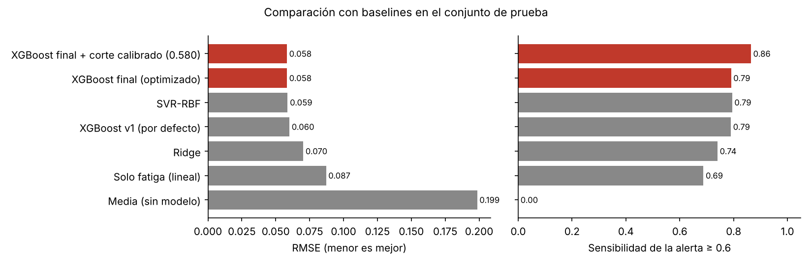
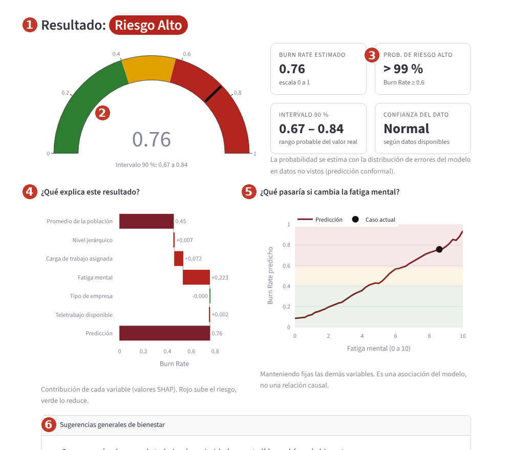
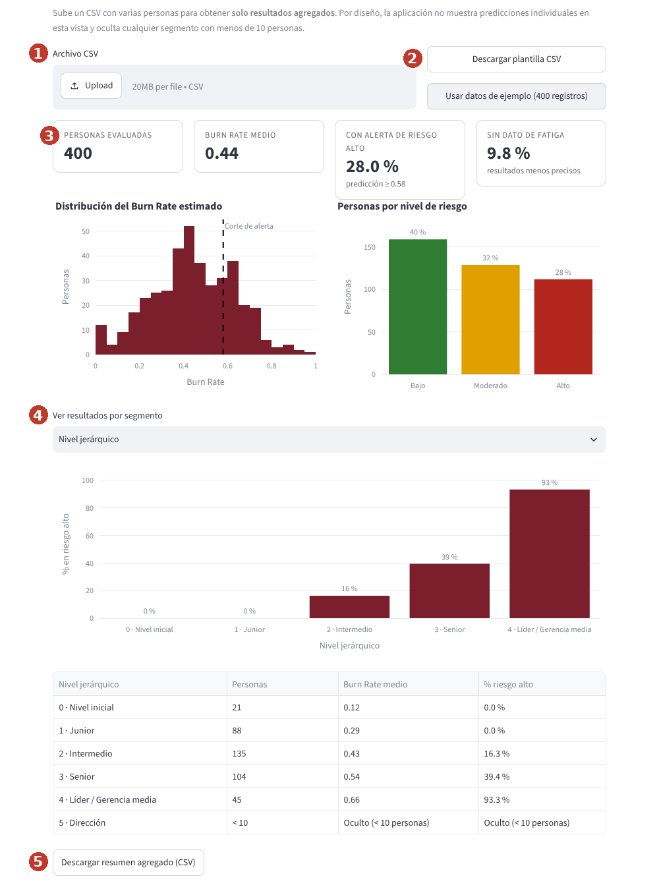

# Predicción de Riesgo de Burnout Organizacional


Sistema de aprendizaje automático que estima el índice de agotamiento laboral (*Burn Rate*) a partir de cinco variables de clima laboral y emite una alerta preventiva de riesgo alto, con intervalos de incertidumbre y explicaciones por variable. Se ofrece como aplicación web pública, diseñada para la prevención y el bienestar con resultados organizacionales solo agregados, nunca para evaluar personas.

**Aplicación en línea:** [https://monitor-burnout-onaranjo.streamlit.app](https://monitor-burnout-onaranjo.streamlit.app) · **Repositorio:** https://github.com/opnaranjo/Proyecto_Integrador_IA

Proyecto Integrador · Maestría en Inteligencia Artificial · Universidad de Especialidades Espíritu Santo (UEES) · Autor: Oscar Paúl Naranjo Castro · Docente: Gladys María Villegas Rugel

---

## Tabla de contenidos

1. [Descripción del problema](#1-descripción-del-problema)
2. [Dataset](#2-dataset)
3. [Metodología](#3-metodología)
4. [Resultados](#4-resultados)
5. [Instalación y uso](#5-instalación-y-uso)
6. [Interfaz de usuario](#6-interfaz-de-usuario)
7. [Despliegue en la nube](#7-despliegue-en-la-nube)
8. [Estructura del proyecto](#8-estructura-del-proyecto)
9. [Consideraciones éticas](#9-consideraciones-éticas)
10. [Autor y contribuciones](#10-autor-y-contribuciones)
11. [Licencia](#11-licencia)
12. [Agradecimientos y referencias](#12-agradecimientos-y-referencias)
13. [Videos](#13-videos)

---

## 1. Descripción del problema

**¿Qué resuelve?** El burnout es un fenómeno ocupacional reconocido por la OMS (CIE-11, QD85) que las organizaciones suelen detectar tarde, cuando ya hay ausentismo, rotación o deterioro de la salud. El proyecto estima, con datos laborales básicos, el nivel de riesgo de agotamiento y señala los casos y segmentos que conviene atender primero.

**¿Por qué importa?**

* Permite pasar de la reacción a la prevención.
* Prioriza recursos de bienestar con evidencia.
* Muestra cómo hacerlo con transparencia sobre la incertidumbre y con salvaguardas éticas explícitas.

**Usuarios objetivo:**

1. **Personas trabajadoras** que quieren autoevaluarse o simular escenarios.
2. **Equipos de bienestar, salud ocupacional o talento humano** que analizan tendencias agregadas de un grupo.

> *Burn Rate* es una variable proxy de un reto de ciencia de datos, no un diagnóstico clínico validado.

## 2. Dataset

| Atributo | Detalle |
|---|---|
| Nombre | *Are Your Employees Burning Out?* |
| Fuente | HackerEarth Machine Learning Challenge, distribuido en [Kaggle](https://www.kaggle.com/datasets/blurredmachine/are-your-employees-burning-out) |
| Licencia | Sin licencia abierta explícita; uso académico no comercial con atribución (ver [`data/README.md`](data/README.md)) |
| Tamaño | 22 750 registros, 9 columnas (21 626 con objetivo) |
| Variables del modelo | Nivel jerárquico, carga de trabajo asignada, fatiga mental, tipo de empresa, teletrabajo |
| Objetivo | *Burn Rate* continuo entre 0 y 1; riesgo alto si es ≥ 0.6 (22.7 % de los casos) |
| Faltantes | Fatiga 9.3 %, carga 6.1 %, objetivo 4.9 % |

El análisis exploratorio completo está en [`docs/analisis_datos.md`](docs/analisis_datos.md).

## 3. Metodología

**Modelo y justificación.** XGBoost de regresión, elegido frente a una media, un baseline lineal de una variable, Ridge y SVR-RBF:

* empata en error con el SVR del precedente académico (Teodósio et al., 2025);
* entrena unas 55 veces más rápido;
* maneja la multicolinealidad;
* permite explicaciones SHAP exactas.

**Preprocesamiento** (dentro de un `Pipeline`, ajustado solo con entrenamiento):

* se eliminan las filas sin objetivo;
* se descartan el identificador y la fecha;
* fatiga y carga se imputan con la mediana más un indicador de dato faltante;
* tipo de empresa y teletrabajo se codifican con one-hot;
* el género se excluye del modelo y se reserva para auditar equidad.

**Optimización:**

* búsqueda bayesiana con Optuna (TPE, 60 pruebas, validación cruzada de 5 pliegues solo en entrenamiento);
* análisis de sensibilidad: importancia fANOVA, gráficos slice, dependencia parcial sobre modelo sustituto e interacciones (H de Friedman);
* corte de la alerta calibrado con predicciones fuera de muestra para lograr una sensibilidad de al menos 85 %;
* intervalos de predicción conformales al 90 %, calibrados según haya o no dato de fatiga.

**Métricas:**

* regresión: RMSE, MAE y R²;
* alerta: sensibilidad (prioritaria), precisión, F1 y AUC-ROC;
* equidad: brechas por grupo, paridad demográfica y odds igualadas (Fairlearn);
* robustez: pruebas de estrés con ruido, faltantes, cambio de prevalencia y cambio de población.

Detalle en [`docs/arquitectura.md`](docs/arquitectura.md) y [`docs/optimizacion.md`](docs/optimizacion.md).

## 4. Resultados

Conjunto de prueba (4 326 registros nunca usados durante el desarrollo):

| Modelo | RMSE | MAE | R² | Sensibilidad | Precisión | AUC |
|---|---|---|---|---|---|---|
| Media (sin modelo) | 0.199 | 0.160 | 0.000 | 0.000 | | 0.500 |
| Baseline una variable (solo fatiga) | 0.087 | 0.063 | 0.808 | 0.688 | 0.850 | 0.940 |
| Ridge | 0.070 | 0.053 | 0.875 | 0.740 | 0.825 | 0.961 |
| SVR-RBF | 0.059 | 0.046 | 0.912 | 0.794 | 0.837 | 0.969 |
| XGBoost por defecto (v1) | 0.060 | 0.047 | 0.908 | 0.790 | 0.826 | 0.967 |
| **XGBoost final (optimizado, corte calibrado 0.58)** | **0.058** | **0.046** | **0.914** | **0.864** | **0.778** | **0.970** |



| KPI planificado | Meta | Logrado |
|---|---|---|
| RMSE | ≤ 0.10 | 0.058 |
| R² | ≥ 0.75 | 0.914 |
| Sensibilidad de la alerta | ≥ 85 % | 86.4 % |
| Precisión de la alerta | ≥ 70 % | 77.8 % |
| Latencia de la app | < 2 000 ms | ≈ 30 ms de cómputo por predicción |

**Dónde funciona bien y dónde no:**

* el error es estable en el rango 0 a 0.8 (MAE ≈ 0.045);
* aumenta en los *Burn Rate* extremos (MAE 0.067) y casi se duplica cuando falta la fatiga mental (RMSE 0.098);
* los intervalos del 90 % cubren el 91 % de los casos reales;
* personas con las mismas entradas visibles pero sin dato de fatiga pueden tener *Burn Rate* reales de 0.16 a 0.64, y el modelo no puede distinguirlas (ver [casos de falla](docs/optimizacion.md#8-casos-donde-el-modelo-falla)).

**Sin sobreajuste:** el RMSE es 0.0577 en entrenamiento, 0.0593 en validación cruzada y 0.0582 en prueba, y la curva de aprendizaje converge ([detalle](docs/optimizacion.md#7-sobreajuste-y-capacidad-de-generalización)).

## 5. Instalación y uso

**Requisitos:** Python 3.11 o superior (probado con 3.13), unos 500 MB de espacio y sin GPU.

```bash
git clone https://github.com/opnaranjo/Proyecto_Integrador_IA.git
cd Proyecto_Integrador_IA
python -m venv .venv
source .venv/bin/activate          # Windows: .venv\Scripts\activate
pip install -r requirements.txt
```

| Tarea | Comando |
|---|---|
| Optimizar hiperparámetros (≈ 2 min) | `python -m src.optimize --trials 60` |
| Entrenar y evaluar (≈ 20 s) | `python -m src.train` |
| Solo evaluar el modelo guardado | `python -m src.evaluate` |
| Ejecutar la aplicación | `streamlit run app/app.py` |
| Ejecutar las pruebas | `pytest` |
| Revisar estilo PEP 8 | `ruff check src app tests` |

**Ejemplo de uso programático:**

```python
import joblib, pandas as pd
model = joblib.load("models/best_model.pkl")
x = pd.DataFrame([{"Designation": 3, "Resource Allocation": 7, "Mental Fatigue Score": 7.5,
                   "Company Type": "Service", "WFH Setup Available": "No"}])
print(model.predict_interval(x))   # pred, lower, upper, p_alert, alert, fatigue_imputed
print(model.explain(x))            # contribución SHAP por variable
```

**Notebooks** (en orden, desde la carpeta `notebooks/`):

1. `01_exploracion`
2. `02_preprocesamiento`
3. `03_modelado`
4. `04_optimizacion`
5. `05_evaluacion`

En Google Colab, ejecute primero `!git clone https://github.com/opnaranjo/Proyecto_Integrador_IA.git`, luego `%cd Proyecto_Integrador_IA/notebooks` y `!pip install -r ../requirements.txt`.

## 6. Interfaz de usuario

La aplicación Streamlit tiene cinco pestañas:

* **Evaluación individual:** formulario validado, cuatro ejemplos precargados y nivel de riesgo con velocímetro. Incluye intervalo del 90 %, probabilidad de riesgo alto, explicación SHAP en cascada, curva "¿qué pasaría si?", sugerencias de bienestar e historial de sesión comparable y exportable a CSV.
* **Análisis organizacional:** carga de CSV o datos de ejemplo, indicadores y gráficos solo agregados, segmentación por nivel, tipo de empresa o teletrabajo con supresión de grupos menores a 10, y plantilla y resumen descargables.
* **Acerca del modelo:** métricas, comparación con baselines, importancia de variables, calidad de los intervalos y limitaciones.
* **Ética y uso responsable:** usos prohibidos, equidad, privacidad y responsabilidad.
* **Ayuda:** instrucciones y preguntas frecuentes.

Las entradas inválidas producen mensajes claros (nunca errores técnicos), la interfaz es responsiva para móvil y admite tema claro u oscuro.





Guía completa con capturas anotadas: [`docs/manual_usuario.md`](docs/manual_usuario.md).

## 7. Despliegue en la nube

**Opción principal: Streamlit Community Cloud** (gratuito, despliega directamente desde GitHub).

1. Ingrese a [share.streamlit.io](https://share.streamlit.io) con la cuenta de GitHub y pulse **Create app** → *Deploy a public app from GitHub*.
2. Repositorio `opnaranjo/Proyecto_Integrador_IA`, rama `main` y archivo principal `app/app.py`.
3. En *Advanced settings* elija **Python 3.13** y pulse **Deploy**. Las dependencias se instalan desde `app/requirements.txt`.

**Alternativa: Hugging Face Spaces (Docker) o Render.** El `Dockerfile` de la raíz sirve la aplicación en el puerto 8501.

1. Cree un Space con SDK **Docker**.
2. Suba el contenido del repositorio y reemplace el `README.md` del Space por [`deploy/huggingface/README.md`](deploy/huggingface/README.md), que contiene la configuración requerida.

Si la versión de las librerías del servidor no pudiera leer `models/best_model.pkl`, la aplicación reentrena el modelo automáticamente al iniciar, a partir de `data/raw/train.csv` y `config.yaml`.

## 8. Estructura del proyecto

```
Proyecto_Integrador_IA/
├── README.md               Este documento
├── requirements.txt        Dependencias completas con versiones fijas
├── config.yaml             Parámetros: rutas, semilla, umbral, hiperparámetros, privacidad
├── pyproject.toml          Configuración de Ruff y pytest
├── Dockerfile              Imagen para Hugging Face Spaces o Render
├── LICENSE                 Licencia MIT
├── docs/                   Planificación, datos, arquitectura, optimización, ética, manual e imágenes
├── data/                   raw/ (dataset original), processed/ (generado) y README con diccionario
├── notebooks/              01 a 05: EDA, preprocesamiento, modelado, optimización y evaluación
├── src/                    Código fuente modular (procesamiento, modelo, optimización, entrenamiento, evaluación)
├── models/                 best_model.pkl, model_v1.pkl, best_params.json y README
├── app/                    app.py (Streamlit), helpers.py, requirements.txt y assets/
├── tests/                  Pruebas unitarias de datos, modelo y aplicación (34 pruebas)
├── results/                figures/ (gráficos), metrics/ (CSV y JSON), reports/
└── deploy/huggingface/     Configuración del Space de Hugging Face
```

## 9. Consideraciones éticas

* **Sesgos:** *Burn Rate* es una variable proxy y la fatiga es autorreportada. Los grupos más afectados son las personas sin dato de fatiga (error casi el doble) y quienes no tienen teletrabajo (más falsas alarmas).
* **Equidad:** el género no se usa como variable. Entre mujeres y hombres el error es igual (brecha de MAE 0.001) y la brecha de sensibilidad es de 5 puntos, documentada y bajo monitoreo.
* **Privacidad:** la app no almacena datos, la vista organizacional solo muestra agregados y oculta grupos de menos de 10 personas, y un uso real requeriría consentimiento según la LOPDP del Ecuador.
* **Transparencia:** explicaciones SHAP por persona, intervalos de incertidumbre y métricas públicas.
* **Limitaciones:** no es un diagnóstico, es sensible al ruido en la medición de la fatiga y fue entrenado con una población de 2008.
* **Uso prohibido:** contratación, despido, evaluación de desempeño, ascensos o sanciones. Las alertas solo deben derivar en conversaciones voluntarias de bienestar.

Análisis completo en [`docs/consideraciones_eticas.md`](docs/consideraciones_eticas.md).

## 10. Autor y contribuciones

| Integrante | Rol |
|---|---|
| Oscar Paúl Naranjo Castro | Trabajo individual: definición del problema, análisis de datos, modelado, optimización, auditoría ética, desarrollo de la aplicación, documentación y presentación |

**Declaración de uso de inteligencia artificial.** Durante el desarrollo se utilizó un asistente de IA generativa (Claude, de Anthropic) como apoyo para programar, estructurar la documentación y revisar resultados. El autor definió el problema y las decisiones de diseño, verificó el código y las cifras contra los resultados ejecutados, y asume la responsabilidad por el contenido.

## 11. Licencia

El código se distribuye bajo licencia [MIT](LICENSE). El dataset pertenece a sus titulares originales y se incluye únicamente con fines académicos.

## 12. Agradecimientos y referencias

A la docente Gladys María Villegas Rugel por la retroalimentación que orientó la comparación con un baseline trivial, el tratamiento del riesgo ético de la predicción individual y la presentación de resultados agregados.

1. B. W. G. Teodósio, M. J. O. T. Lira, P. H. M. Araújo y L. R. C. Farias, "Support vector machine-based burnout risk prediction with an interactive interface for organizational use", arXiv:2510.25509, 2025.
2. T. Chen y C. Guestrin, "XGBoost: A scalable tree boosting system", *Proc. ACM SIGKDD*, 2016.
3. T. Akiba, S. Sano, T. Yanase, T. Ohta y M. Koyama, "Optuna: A next-generation hyperparameter optimization framework", *Proc. ACM SIGKDD*, 2019.
4. S. M. Lundberg et al., "From local explanations to global understanding with explainable AI for trees", *Nature Machine Intelligence*, 2(1), 56-67, 2020.
5. A. N. Angelopoulos y S. Bates, "A gentle introduction to conformal prediction and distribution-free uncertainty quantification", arXiv:2107.07511, 2021.
6. S. Bird et al., "Fairlearn: A toolkit for assessing and improving fairness in AI", Microsoft, MSR-TR-2020-32, 2020.
7. World Health Organization, "Burn-out an 'occupational phenomenon': International Classification of Diseases", 2019.
8. HackerEarth, *Are Your Employees Burning Out?* (dataset), distribuido en Kaggle.

## 13. Videos

* **Video pitch (5 minutos):** URL_VIDEO_PITCH
* **Video de respuestas a las preguntas:** URL_VIDEO_PREGUNTAS

| Repositorio | Aplicación |
|---|---|
|  |  |
