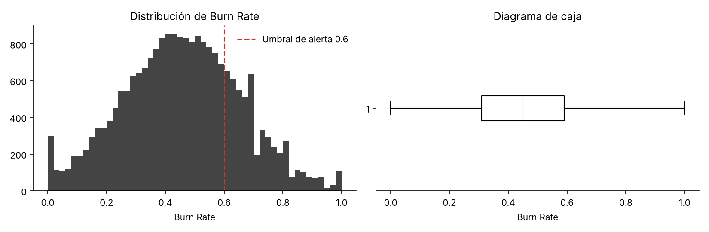
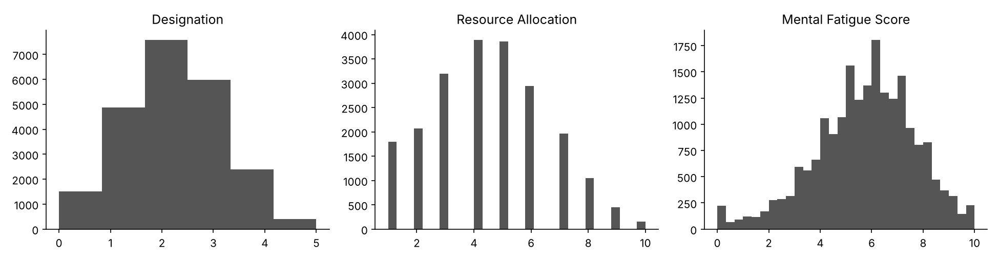
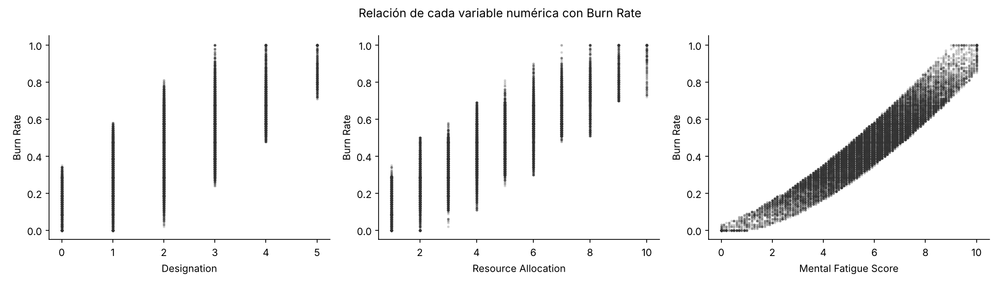
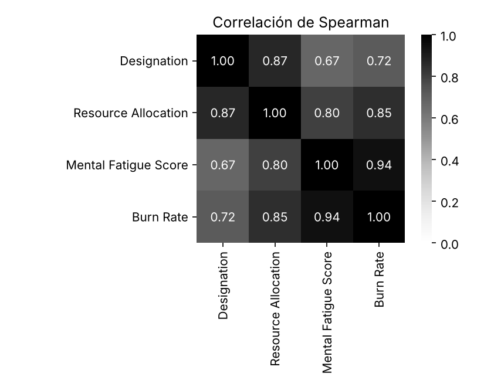
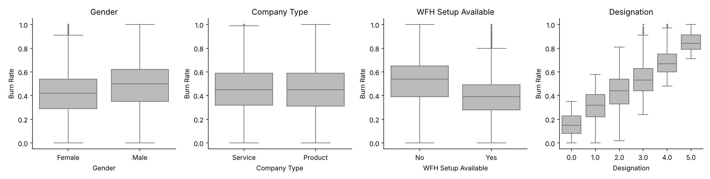
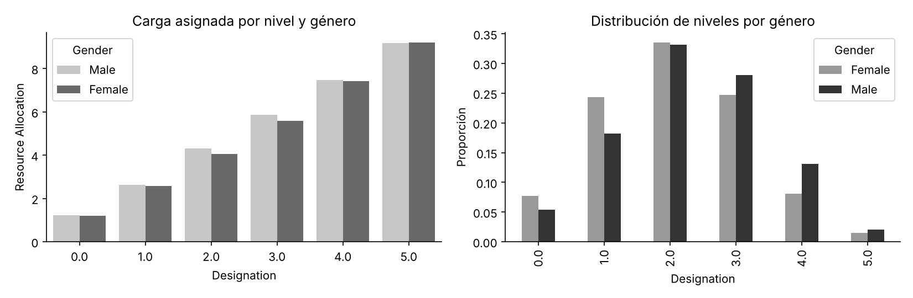

# Análisis exploratorio de datos

El análisis completo y reproducible está en [`notebooks/01_exploracion.ipynb`](../notebooks/01_exploracion.ipynb) y la preparación en [`notebooks/02_preprocesamiento.ipynb`](../notebooks/02_preprocesamiento.ipynb). Este documento resume los hallazgos y justifica las decisiones de preprocesamiento.

## 1. Descripción del dataset

| Atributo | Valor |
|---|---|
| Nombre | *Are Your Employees Burning Out?* (HackerEarth, distribuido en Kaggle) |
| Archivo | `data/raw/train.csv` |
| Registros | 22 750 (21 626 con variable objetivo) |
| Columnas | 9: 1 identificador, 1 fecha, 3 categóricas, 1 ordinal, 2 numéricas y el objetivo |
| Objetivo | *Burn Rate*, continuo entre 0 y 1 |
| Completitud | 97.7 % de las celdas |

El diccionario de variables está en [`data/README.md`](../data/README.md).

## 2. Estadísticas descriptivas

| Variable | Media | Desv. est. | Mín. | Mediana | Máx. | Faltantes |
|---|---|---|---|---|---|---|
| Designation | 2.18 | 1.14 | 0 | 2 | 5 | 0 % |
| Resource Allocation | 4.48 | 2.05 | 1 | 4 | 10 | 6.1 % |
| Mental Fatigue Score | 5.73 | 1.92 | 0 | 5.9 | 10 | 9.3 % |
| Burn Rate | 0.452 | 0.198 | 0 | 0.45 | 1 | 4.9 % |

| Categórica | Distribución | Burn Rate medio | % con Burn Rate ≥ 0.6 |
|---|---|---|---|
| Gender | Female 52.3 % · Male 47.7 % | 0.423 · 0.484 | 17.5 % · 28.3 % |
| Company Type | Service 65.2 % · Product 34.8 % | 0.453 · 0.451 | 22.9 % · 22.2 % |
| WFH Setup Available | Yes 54.0 % · No 46.0 % | 0.396 · 0.518 | 12.9 % · 34.1 % |

## 3. Visualizaciones

**Variable objetivo.** Distribución casi simétrica (asimetría 0.05) centrada en 0.45. El 22.7 % de los registros supera el umbral de riesgo alto (0.6), un desbalance moderado para la alerta.

**Variables numéricas.** *Designation* concentra la mayoría de casos en los niveles 1 a 3; la fatiga se aproxima a una normal centrada en 5.9.

**Relación con el objetivo.** La fatiga mental muestra una relación casi lineal con *Burn Rate*; la carga asignada y el nivel jerárquico, una relación creciente en escalones.

**Correlaciones (Spearman).**

**Variables categóricas.**

**Contexto de género.** Los hombres tienen en promedio más carga asignada (4.79 frente a 4.20) y mayor presencia en los niveles 3 a 5, lo que explica parte de su mayor *Burn Rate* medio.

## 4. Patrones, correlaciones y valores atípicos

* **Señal dominante.** *Mental Fatigue Score* tiene una correlación de Spearman de 0.94 con el objetivo; *Resource Allocation*, 0.85; *Designation*, 0.72. Un modelo lineal con solo la fatiga ya explica el 81 % de la varianza (con imputación por mediana). Sobre las filas con fatiga observada, la misma regresión logra RMSE ≈ 0.065 y R² ≈ 0.89. Por eso cualquier modelo debe compararse con este baseline trivial.
* **Multicolinealidad.** *Designation* y *Resource Allocation* correlacionan 0.87 entre sí: la carga asignada crece con el nivel jerárquico (de 1.2 en el nivel 0 a 9.2 en el nivel 5). Esto favorece modelos de árboles o regularizados y obliga a leer la importancia de variables con cautela.
* **Escalones por nivel.** En los niveles 0 y 1 no existe ningún caso con *Burn Rate* ≥ 0.6, mientras que en el nivel 5 lo supera el 94.5 %.
* **Confusión del teletrabajo.** Quienes no tienen teletrabajo presentan más carga (5.11 frente a 3.94) y más fatiga (6.30 frente a 5.24). La gran diferencia bruta de *Burn Rate* entre ambos grupos se explica casi por completo por esas variables: en el modelo, el teletrabajo aporta menos del 1 % de la importancia.
* **Tipo de empresa.** No separa el riesgo (0.451 frente a 0.453).
* **Atípicos.** Con el criterio de 1.5 veces el rango intercuartílico solo aparecen 347 valores bajos de fatiga, todos dentro de la escala válida de 0 a 10. Se interpretan como personas con poca fatiga, no como errores, y se conservan. *Burn Rate* y *Resource Allocation* no tienen atípicos.
* **Fecha de ingreso.** Todas las fechas pertenecen al año 2008 y su correlación con el objetivo es 0.001: no aporta información.

## 5. Manejo de datos faltantes

| Variable | Faltantes | Burn Rate medio con dato / sin dato | Decisión |
|---|---|---|---|
| Burn Rate | 1 124 (4.9 %) | No aplica | Se eliminan las filas: imputar el objetivo fabricaría etiquetas |
| Mental Fatigue Score | 2 117 (9.3 %) | 0.452 / 0.452 | Mediana de entrenamiento + indicador binario de faltante |
| Resource Allocation | 1 381 (6.1 %) | 0.452 / 0.449 | Mediana de entrenamiento + indicador binario de faltante |

El *Burn Rate* medio es idéntico con y sin dato, lo que es consistente con faltantes completamente al azar (MCAR). La imputación por mediana no introduce un sesgo sistemático, pero sí pierde información individual: las personas sin dato de fatiga reciben predicciones con casi el doble de error. El indicador de faltante permite al modelo tratarlas de forma distinta (en validación cruzada reduce su RMSE de 0.105 a 0.102 sin perjudicar al resto), y la aplicación les asigna intervalos más anchos y un aviso visible.

## 6. Desbalance

La alerta (*Burn Rate* ≥ 0.6) tiene una prevalencia del 22.7 %. No se aplicó sobremuestreo porque el modelo es de regresión; en su lugar:

* la partición entrenamiento/prueba se estratificó por la alerta;
* se reportan sensibilidad, precisión, F1 y AUC además del error de regresión;
* el corte de la alerta se calibró con validación cruzada para alcanzar la sensibilidad objetivo (ver `arquitectura.md`).

## 7. Decisiones de preprocesamiento

| # | Decisión | Justificación |
|---|---|---|
| 1 | Eliminar filas sin objetivo | No fabricar etiquetas |
| 2 | Descartar `Employee ID` y `Date of Joining` | Identificador sin valor predictivo; fecha sin variabilidad útil |
| 3 | Imputar fatiga y carga con la mediana de entrenamiento y añadir indicadores de faltante | Faltantes compatibles con MCAR; robustez ante valores extremos; trato diferenciado de casos imputados |
| 4 | One-hot de `Company Type` y `WFH Setup Available` con categoría de referencia | Variables nominales binarias |
| 5 | Mantener `Designation` como ordinal numérica | Su orden tiene significado (nivel jerárquico) |
| 6 | Excluir `Gender` del modelo y conservarlo solo para auditar | Aporta apenas el 0.2 % de la ganancia del modelo y no mejora el error; evita discriminación directa |
| 7 | Partición 80/20 estratificada con semilla 42 | Reproducibilidad y misma prevalencia en ambos conjuntos |
| 8 | Todo dentro de un `Pipeline` de scikit-learn | Evitar fuga de información en validación cruzada y en producción |
| 9 | Sin escalado para XGBoost | Los árboles no dependen de la escala; los baselines lineales y el SVR sí se escalan |

## 8. Limitación estructural del dataset

El dataset no contiene área o departamento, antigüedad real, edad, salario, horas extra ni satisfacción laboral, y no documenta cómo se midieron la fatiga ni el *Burn Rate*. Por ello los análisis organizacionales de la aplicación se segmentan por nivel jerárquico, tipo de empresa y teletrabajo, y todos los resultados se presentan como validación simulada, no clínica.
