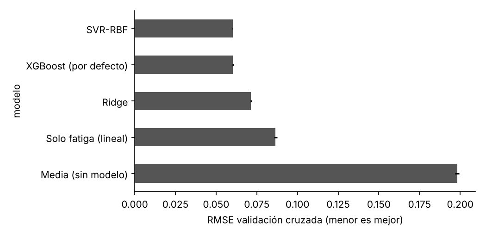
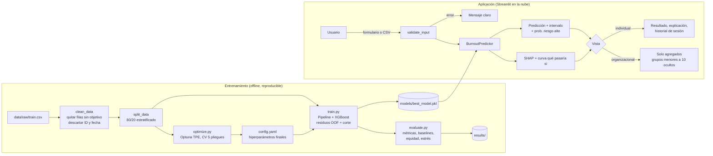
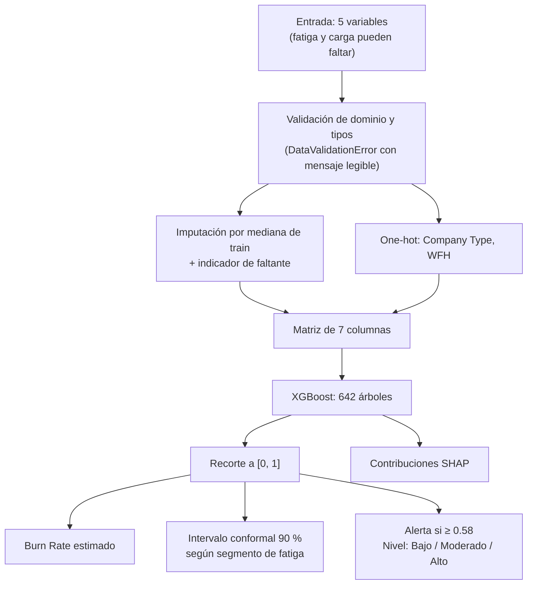

# Diseño del modelo y arquitectura

## 1. Tipo de modelo y justificación

**Modelo seleccionado: XGBoost de regresión** (*gradient boosting* de árboles de decisión) que estima *Burn Rate* en el rango 0 a 1, con tres componentes adicionales: una **alerta de riesgo alto** con corte calibrado, **intervalos de predicción conformales** y **explicaciones SHAP** por persona.

Se compararon cinco alternativas con validación cruzada de 5 pliegues sobre el conjunto de entrenamiento:

| Modelo | RMSE CV | R² CV | R² train | Segundos por pliegue |
|---|---|---|---|---|
| Media (sin modelo) | 0.198 | 0.000 | 0.000 | 0.01 |
| Solo fatiga, regresión lineal (baseline exigido) | 0.087 | 0.809 | 0.809 | 0.01 |
| Ridge (todas las variables) | 0.072 | 0.870 | 0.870 | 0.02 |
| SVR-RBF (réplica de Teodósio et al., 2025) | 0.060 | 0.908 | 0.912 | 4.50 |
| XGBoost con parámetros por defecto | 0.060 | 0.907 | 0.923 | 0.08 |

XGBoost y SVR empatan en error. Se eligió XGBoost porque:

1. **Eficiencia:** entrena unas 55 veces más rápido que el SVR, lo que permite optimizar hiperparámetros y reentrenar en el servidor si hace falta.
2. **Multicolinealidad y no linealidad:** los árboles capturan los escalones por nivel jerárquico sin supuestos de linealidad.
3. **Explicabilidad exacta:** XGBoost calcula valores SHAP exactos (TreeSHAP) sin librerías adicionales.
4. **Datos faltantes:** combinado con el indicador de faltante, trata de forma diferenciada a las personas sin dato de fatiga.
5. **Sobreajuste controlado:** la diferencia entre R² de entrenamiento y de validación es de 0.015.

## 2. Arquitectura detallada del modelo

| Componente | Configuración |
|---|---|
| Entradas | `Designation` (0 a 5), `Resource Allocation` (1 a 10), `Mental Fatigue Score` (0 a 10), `Company Type`, `WFH Setup Available` |
| Preprocesamiento | `SimpleImputer(median, add_indicator=True)` para numéricas y `OneHotEncoder(drop="first")` para categóricas; salida de 7 columnas |
| Estimador | `XGBRegressor(objective="reg:squarederror", tree_method="hist")` |
| Hiperparámetros | `n_estimators=642`, `learning_rate=0.0185`, `max_depth=5`, `min_child_weight=3.59`, `subsample=0.532`, `colsample_bytree=0.975`, `reg_lambda=0.194`, `reg_alpha=0.0059` |
| Tamaño | 642 árboles de profundidad máxima 5 (hasta 31 hojas cada uno); archivo serializado de 1.8 MB |
| Post-procesamiento | Recorte de la predicción al rango [0, 1] |
| Alerta | Riesgo alto si *Burn Rate* real ≥ 0.60. El modelo alerta si su predicción es ≥ **0.58**, corte elegido con predicciones fuera de muestra de entrenamiento como el más alto que logra sensibilidad ≥ 85 % |
| Incertidumbre | Intervalo conformal al 90 % a partir de residuos de validación cruzada, calibrado por separado para fatiga observada (ancho medio 0.17) e imputada (0.32); probabilidad de riesgo alto = proporción de residuos que llevan la predicción sobre 0.6 |
| Explicación | Contribuciones SHAP por variable original (los indicadores y columnas one-hot se agregan a su variable de origen) |

El objeto `BurnoutPredictor` (`src/model.py`) encapsula el pipeline, el corte, los residuos de calibración y los metadatos, y expone `predict`, `predict_interval`, `explain` y `feature_importance`.

## 3. Diagrama de flujo del sistema completo

## 4. Pipeline de datos: de la entrada a la salida

Niveles de riesgo mostrados en la aplicación: **Bajo** (< 0.40), **Moderado** (0.40 a 0.58) y **Alto** (≥ 0.58, coincide con la alerta).

## 5. Organización del código

| Módulo | Responsabilidad |
|---|---|
| `src/utils.py` | Configuración YAML, rutas relativas a la raíz, logging, semillas, JSON |
| `src/data_processing.py` | Carga, limpieza, partición, preprocesador y validación de entradas |
| `src/model.py` | Pipelines, baselines, calibración del corte y clase `BurnoutPredictor` |
| `src/optimize.py` | Búsqueda con Optuna y análisis de sensibilidad de hiperparámetros |
| `src/evaluate.py` | Métricas, equidad, intervalos, pruebas de estrés y figuras |
| `src/train.py` | Orquestación del entrenamiento y la evaluación (línea de comandos) |
| `app/helpers.py` | Lógica de la aplicación independiente de la interfaz (probada con pytest) |
| `app/app.py` | Interfaz Streamlit |

Todos los parámetros (rutas, semilla, umbral, sensibilidad mínima, hiperparámetros, tamaño mínimo de grupo) viven en `config.yaml`.

## 6. Tecnologías y versiones

| Tecnología | Versión | Uso |
|---|---|---|
| Python | 3.13 | Lenguaje |
| NumPy / pandas | 2.5.3 / 3.0.5 | Manipulación de datos |
| scikit-learn | 1.9.1 | Pipeline, preprocesamiento, baselines, validación cruzada |
| XGBoost | 3.4.1 | Modelo principal y SHAP exacto |
| Optuna | 5.0.0 | Optimización bayesiana (TPE) e importancia fANOVA |
| Fairlearn | 0.15.0 | Métricas de equidad (paridad demográfica, odds igualadas) |
| Matplotlib / Seaborn | 3.11.2 / 0.13.2 | Figuras de análisis |
| Streamlit | 1.66.1 | Interfaz web |
| Plotly | 7.1.0 | Gráficos interactivos de la app |
| pytest / Ruff | 9.1.1 / 0.17.2 | Pruebas y estilo PEP 8 |
| Streamlit Community Cloud / Docker | | Despliegue |
