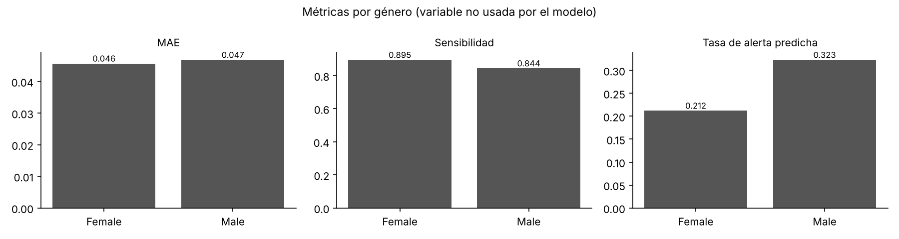
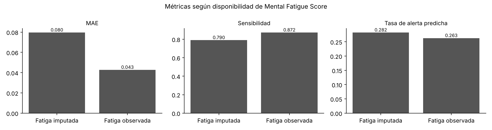
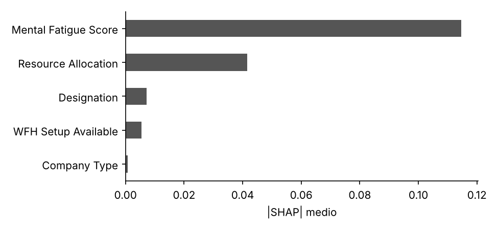

# Consideraciones éticas

Un sistema que estima el agotamiento de las personas en su trabajo toca la salud mental, la relación de poder entre empleador y empleado, y la privacidad. Por eso la ética no se trató como un anexo: condicionó qué variables usa el modelo, cómo se calibra la alerta, qué muestra la aplicación y qué prohíbe. Las cifras de este documento provienen de `results/metrics/` (conjunto de prueba, 4 326 registros).

> **Contexto.** El proyecto es académico. La organización usuaria, el equipo de talento humano y el comité de ética mencionados son escenarios simulados que ilustran cómo debería gobernarse el sistema en un despliegue real.

## 1. Análisis de sesgos

**Sesgos del dataset**

| Tipo de sesgo | Evidencia | Riesgo |
|---|---|---|
| Validez del constructo | *Burn Rate* proviene de un reto de ciencia de datos y no de un instrumento validado (Maslach Burnout Inventory, Burnout Assessment Tool). No se documenta cómo se calculó | El modelo aprende a reproducir una métrica proxy; tratarlo como diagnóstico sería un error grave |
| Representatividad temporal y geográfica | Todas las fechas de ingreso son de 2008; país e industria no documentados | Las relaciones aprendidas pueden no valer en organizaciones actuales ni en Ecuador |
| Variable autorreportada | *Mental Fatigue Score* explica cerca del 80 % de la predicción y probablemente es una autoevaluación | Quien minimiza su cansancio (por cultura, miedo o estigma) recibe un riesgo más bajo del real |
| Variables omitidas | Sin área, edad, antigüedad real, horas extra, salario ni cargas de cuidado | Causas relevantes del burnout quedan invisibles; el modelo no sirve para explicar por qué ocurre |
| Diferencias por género | Los hombres muestran mayor *Burn Rate* medio (0.484 frente a 0.423), acompañado de mayor carga y mayor presencia en niveles altos | Riesgo de que el modelo use el género como atajo |
| Datos faltantes | 9.3 % sin dato de fatiga | Peor calidad de predicción para ese grupo |

**Grupos que podrían ser perjudicados**

1. **Personas sin dato de fatiga:** su error casi se duplica (RMSE 0.098 frente a 0.052) y su sensibilidad baja de 0.87 a 0.79. Es el grupo más afectado.
2. **Niveles jerárquicos intermedios (nivel 2):** sensibilidad de 0.70, la más baja. Sus casos de riesgo alto suelen estar justo en el límite.
3. **Niveles de liderazgo (nivel 4):** concentran falsas alarmas (77 % de quienes no están en riesgo alto reciben alerta), porque casi todos están cerca de 0.6. Una alerta generalizada puede estigmatizar al grupo.
4. **Personas sin teletrabajo:** reciben más falsas alarmas (14.1 % frente a 3.8 %), porque tienen en promedio más carga y fatiga y muchas quedan cerca del corte.
5. **Personas que subreportan su fatiga:** riesgo no medible con este dataset, pero previsible.

## 2. Equidad y fairness

**Estrategias de mitigación implementadas**

| Estrategia | Etapa | Efecto medido |
|---|---|---|
| Excluir `Gender` como variable de entrada y conservarlo solo para auditar | Preprocesamiento | Aporta el 0.2 % de la ganancia; con y sin género el RMSE es idéntico (0.0582) |
| Indicador de dato faltante para fatiga y carga | Modelo | Mejora el error del grupo con fatiga imputada en validación cruzada |
| Intervalos conformales calibrados por segmento | Salida | Cobertura del 92 % en el grupo con fatiga imputada y del 91 % en el resto: la incertidumbre se comunica honestamente (ancho 0.32 frente a 0.17) |
| Corte de alerta calibrado para sensibilidad ≥ 85 % | Decisión | Menos casos de riesgo alto sin detectar en todos los grupos |
| Aviso visible cuando falta la fatiga | Interfaz | La persona sabe que el resultado es menos confiable |

**Métricas evaluadas por grupo** (Fairlearn 0.15; alerta con el corte de 0.58)

| Grupo | n | MAE | Sensibilidad | Falsas alarmas | Tasa de alerta predicha | Tasa real de riesgo alto |
|---|---|---|---|---|---|---|
| Mujeres | 2 269 | 0.046 | 0.895 | 6.1 % | 21.2 % | 18.1 % |
| Hombres | 2 057 | 0.047 | 0.844 | 9.8 % | 32.3 % | 30.2 % |
| Fatiga observada | 3 915 | 0.043 | 0.872 | 7.3 % | 26.3 % | 23.8 % |
| Fatiga imputada | 411 | 0.080 | 0.790 | 11.9 % | 28.2 % | 24.3 % |
| Con teletrabajo | 2 389 | 0.046 | 0.847 | 3.8 % | 15.5 % | 14.5 % |
| Sin teletrabajo | 1 937 | 0.047 | 0.873 | 14.1 % | 40.0 % | 35.4 % |

| Métrica de equidad | Género | Fatiga faltante | Teletrabajo |
|---|---|---|---|
| Diferencia de paridad demográfica (DPD) | 0.111 | 0.026 | 0.244 |
| Diferencia de odds igualadas (EOD) | 0.051 | 0.078 | 0.102 |
| Brecha de MAE | 0.001 | 0.037 | 0.001 |

**Interpretación**

* **¿Trata el modelo a todos los grupos de forma equitativa?** En calidad de predicción, sí entre mujeres y hombres: el error es prácticamente igual. La DPD de 0.11 no indica discriminación, porque refleja una diferencia real en la tasa de riesgo alto (30 % frente a 18 %); forzar paridad de alertas obligaría a ignorar casos reales en un grupo. La métrica pertinente es la de odds igualadas: hay una brecha de 5 puntos de sensibilidad a favor de las mujeres y de 3.7 puntos en falsas alarmas en contra de los hombres. Es moderada, se documenta y queda bajo monitoreo.
* **Teletrabajo:** la brecha de falsas alarmas (10.2 puntos) es la mayor del análisis y alcanza el umbral de revisión definido en el plan de monitoreo. No es una variable protegida, pero una alerta de más en un grupo puede generar estigma o intervenciones innecesarias. Si el sistema se desplegara, se recomienda revisar el corte por segmento o acompañar las alertas de ese grupo con una segunda evaluación.
* **La inequidad más importante no es demográfica sino de calidad de datos:** el grupo sin dato de fatiga tiene el doble de error. Por eso la mitigación más relevante es la de datos faltantes.

## 3. Privacidad

* **Datos personales y sensibles:** el dataset de entrenamiento es anónimo (solo un identificador aleatorio). En un uso real, la fatiga mental y el riesgo de burnout son **datos relativos a la salud**, que la Ley Orgánica de Protección de Datos Personales del Ecuador (LOPDP, 2021) y el RGPD europeo (art. 9) clasifican como categorías especiales que exigen protección reforzada.
* **Protección en la aplicación:**
  * no hay registro de usuarios ni base de datos: las entradas se procesan en memoria y el historial vive solo en la sesión del navegador;
  * la vista organizacional muestra **solo agregados** y **oculta cualquier segmento con menos de 10 personas** (principio de k-anonimato), incluido su conteo exacto;
  * el CSV subido no se guarda en disco ni se devuelve con predicciones individuales.
* **Cumplimiento para un despliegue real:**
  * consentimiento informado, explícito y revocable;
  * finalidad limitada al bienestar;
  * evaluación de impacto de protección de datos antes de implementar;
  * derecho de la persona a no ser objeto de decisiones basadas únicamente en tratamientos automatizados (LOPDP, art. 20; RGPD, art. 22);
  * y cumplimiento de las normas de no discriminación laboral (Acuerdo Ministerial MDT-2017-0082).
* **Marco de referencia regulatorio:** el Reglamento Europeo de IA (AI Act, Anexo III, punto 4) clasifica como de **alto riesgo** los sistemas de IA usados para tomar decisiones que afecten relaciones laborales o para monitorear y evaluar el comportamiento de trabajadores. Aunque no aplica en Ecuador, se adopta como estándar de buenas prácticas.

## 4. Transparencia y explicabilidad

* **Interpretabilidad del modelo:** XGBoost no es interpretable a simple vista, por lo que se añadió explicabilidad en dos niveles:
  * **global:** importancia por ganancia y valores SHAP medios (fatiga 79 %, carga 18 %, nivel 2 %, teletrabajo y tipo de empresa menos del 1 %);
  * **local:** para cada evaluación, un gráfico de cascada con la contribución SHAP exacta de cada variable (calculada con TreeSHAP) y una curva de "¿qué pasaría si?" que muestra cómo cambia el riesgo al variar la fatiga.
* **Comprensión por usuarios no técnicos:** la app traduce el resultado a niveles (Bajo, Moderado, Alto), muestra un intervalo en lugar de un número falsamente preciso, evita afirmar certezas absolutas (muestra "> 99 %" en lugar de "100 %") y aclara que las relaciones son asociaciones del modelo, no causas.
* **Transparencia del sistema:** la pestaña "Acerca del modelo" publica métricas, comparación con baselines, cobertura de intervalos y limitaciones; el repositorio documenta datos, código y decisiones.

## 5. Impacto social

| | Impactos positivos | Impactos negativos posibles |
|---|---|---|
| Personas trabajadoras | Autoevaluación privada; lenguaje de prevención; orientación a buscar apoyo | Etiquetamiento, ansiedad ante un resultado "Alto", presión para ocultar la fatiga si temen consecuencias |
| Equipos de bienestar | Priorizar programas preventivos por segmento con evidencia | Confiar de más en una métrica proxy; desatender causas organizacionales no medidas |
| Organización | Detección más temprana de focos de desgaste | Uso del sistema para vigilancia o para justificar decisiones de personal |

**Quiénes se benefician:** personas que quieren reflexionar sobre su carga y equipos de salud ocupacional que necesitan priorizar recursos. **Quiénes podrían resultar perjudicados:** trabajadores evaluados sin su consentimiento, grupos con datos incompletos y niveles con muchas falsas alarmas.

## 6. Responsabilidad

* **Si el modelo falla:**
  * el desarrollador responde por la calidad técnica, la documentación honesta de limitaciones y la corrección de errores reportados;
  * la organización que lo despliega responde por el uso, el consentimiento y la gobernanza de los datos;
  * ninguna decisión sobre una persona puede atribuirse al modelo, porque el diseño exige supervisión humana.
* **Mecanismos de rendición de cuentas implementados:**
  * versionado del modelo con fecha y métricas en sus metadatos;
  * pruebas automatizadas;
  * resultados reproducibles con semilla fija;
  * registro (logging) de eventos de carga y reentrenamiento;
  * documentación pública de decisiones.
* **Plan de monitoreo y actualización** (para un despliegue real):

| Qué se monitorea | Frecuencia | Umbral de acción |
|---|---|---|
| Tasa de datos faltantes de fatiga | Mensual | Más del 10 % |
| Distribución de fatiga y de *Burn Rate* predicho | Trimestral | Cambio significativo frente al entrenamiento (prueba de Kolmogorov-Smirnov) |
| Brechas de sensibilidad por grupo | Trimestral | Más de 10 puntos |
| Desempeño con datos etiquetados nuevos | Semestral | RMSE mayor a 0.08 o sensibilidad menor a 80 % |
| Revisión ética y de uso | Anual | Siempre que cambie el propósito |

## 7. Uso dual y mal uso

**Usos maliciosos posibles:** seleccionar personas para despido o no renovación, condicionar ascensos o bonos, vigilancia encubierta del personal, o presionar a quienes reportan fatiga alta.

**Salvaguardas implementadas:**

* advertencia de **uso prohibido** visible en la aplicación y en la documentación;
* la vista organizacional no permite descargar ni ver predicciones individuales;
* supresión de segmentos pequeños para impedir reidentificar personas;
* el modelo no usa identificadores ni género;
* las sugerencias de la app son generales y orientadas al autocuidado, nunca disciplinarias;
* licencia y documentación declaran el alcance académico.

**Limitación honesta:** la vista individual permite evaluar a cualquier persona si alguien introduce sus datos. La salvaguarda es organizacional (políticas de uso, consentimiento y auditoría), no técnica.

## 8. Limitaciones reconocidas

**No debe usarse para:**

* diagnosticar burnout ni ninguna condición de salud;
* tomar o respaldar decisiones de contratación, despido, evaluación de desempeño, ascenso o sanción;
* evaluar a personas sin su conocimiento y consentimiento;
* poblaciones muy distintas de la de entrenamiento sin una revalidación previa.

**Advertencias a los usuarios (presentes en la app):**

* *Burn Rate* es un índice proxy, no una medida clínica;
* el resultado tiene un margen de error (intervalo del 90 %);
* las relaciones son asociaciones estadísticas, no causas;
* sin dato de fatiga la predicción es mucho menos confiable.

**Casos límite donde el modelo no es confiable:**

* falta la fatiga mental o se midió con otro instrumento;
* valores fuera del rango de entrenamiento;
* *Burn Rate* reales extremos (mayores de 0.8), donde el error sube a MAE 0.067 porque el modelo tiende hacia el centro;
* organizaciones con una prevalencia de burnout muy baja (la precisión cae a 55 %);
* datos con ruido de medición, que degradan la sensibilidad rápidamente.

## Referencias

* World Health Organization (2019). *Burn-out an "occupational phenomenon": International Classification of Diseases*.
* Asamblea Nacional del Ecuador (2021). *Ley Orgánica de Protección de Datos Personales*. Registro Oficial Suplemento 459.
* Ministerio del Trabajo del Ecuador (2017). *Acuerdo Ministerial MDT-2017-0082: Normativa para la erradicación de la discriminación en el ámbito laboral*.
* Parlamento Europeo y Consejo (2016). *Reglamento (UE) 2016/679 (RGPD)*, artículos 9 y 22.
* Parlamento Europeo y Consejo (2024). *Reglamento (UE) 2024/1689 de Inteligencia Artificial*, Anexo III.
* S. Bird et al. (2020). *Fairlearn: A toolkit for assessing and improving fairness in AI*. Microsoft, MSR-TR-2020-32.
* S. M. Lundberg et al. (2020). "From local explanations to global understanding with explainable AI for trees". *Nature Machine Intelligence*, 2, 56-67.
