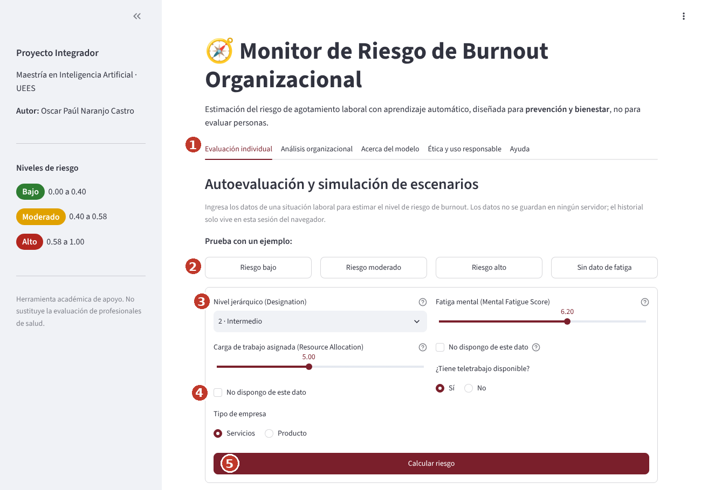
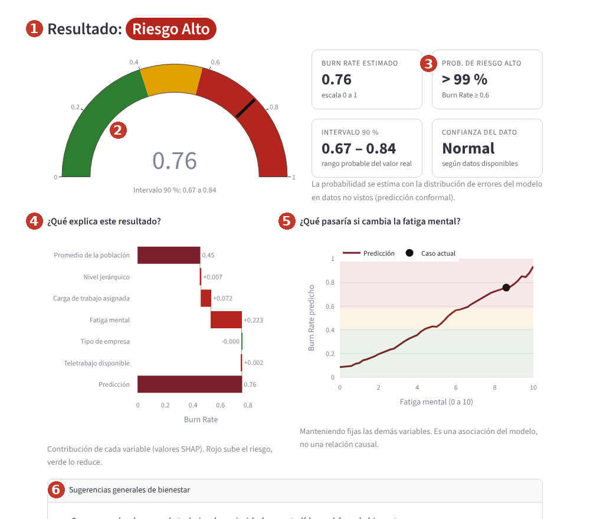
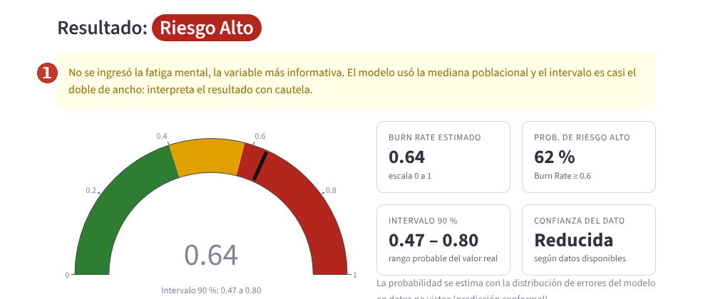
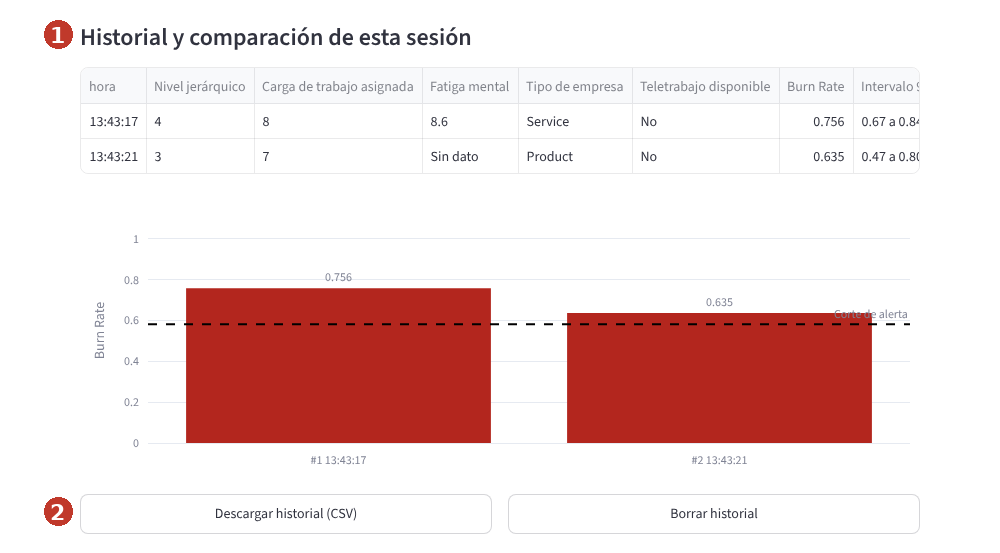
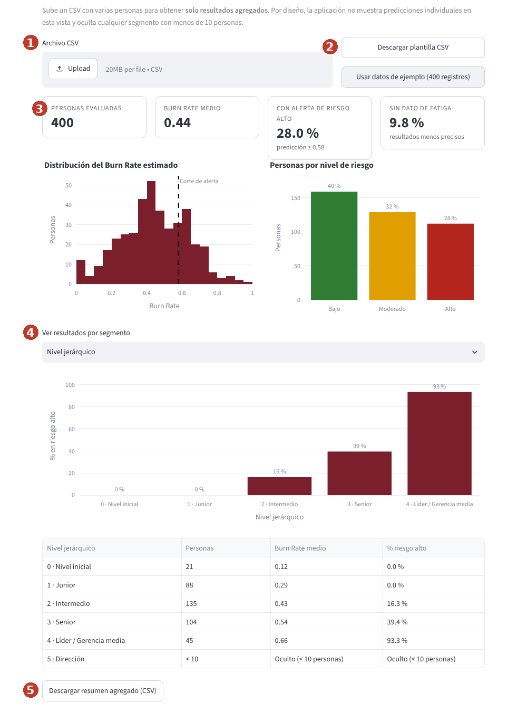
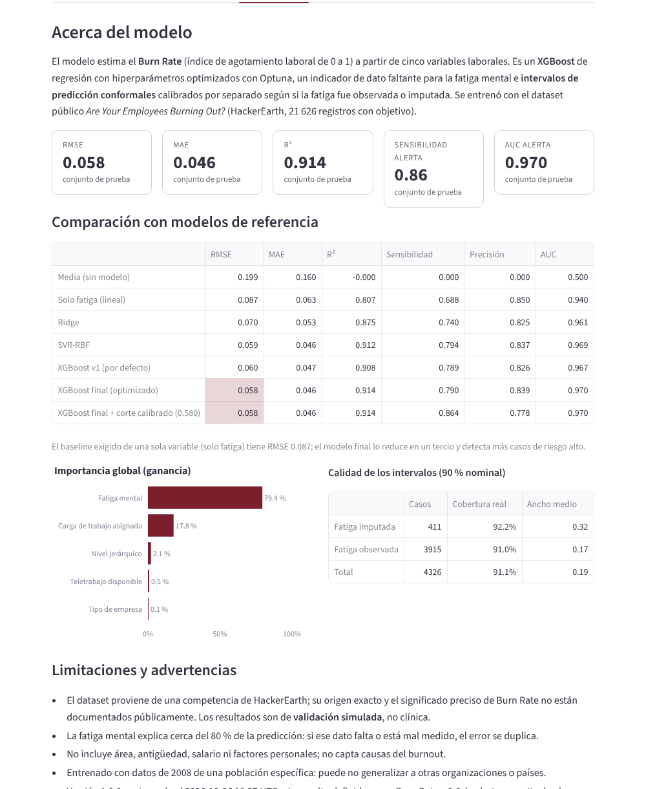
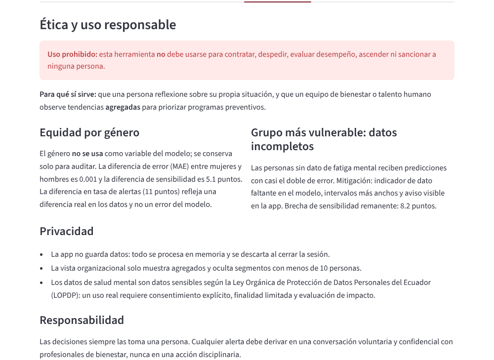
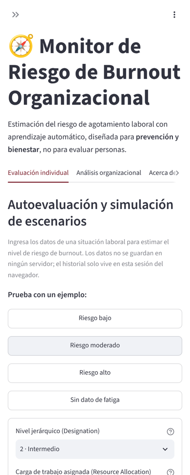
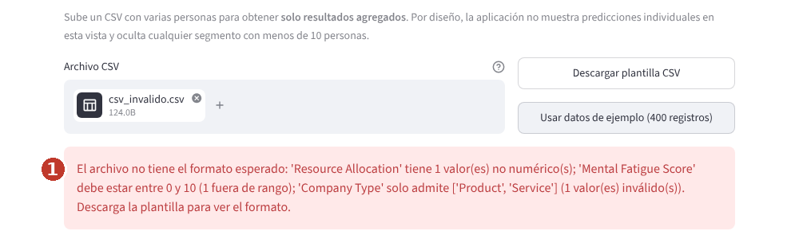

# Manual de usuario

**Monitor de Riesgo de Burnout Organizacional** es una aplicación web que estima el nivel de riesgo de agotamiento laboral a partir de cinco datos laborales. Está pensada para dos usos:

* **Autoevaluación y simulación:** una persona revisa su propia situación o explora escenarios.
* **Análisis organizacional:** un equipo de bienestar observa tendencias **agregadas** de un grupo.

> La herramienta no es un diagnóstico médico ni psicológico y **no debe usarse para decisiones sobre personas** (contratación, despido, evaluación de desempeño, ascensos o sanciones).

## Acceso

* **En línea:** abra el enlace de la aplicación desplegada que figura en el README del repositorio. No requiere cuenta ni instalación.
* **Local:** desde la raíz del repositorio ejecute `streamlit run app/app.py` y abra `http://localhost:8501`.

La aplicación funciona en navegadores de escritorio y móviles. El tema claro u oscuro se cambia en el menú ⋮ (arriba a la derecha) → *Settings* → *Theme*.

## 1. Evaluación individual

1. **Pestañas.** La aplicación tiene cinco secciones: Evaluación individual, Análisis organizacional, Acerca del modelo, Ética y uso responsable, y Ayuda.
2. **Ejemplos precargados.** Cada botón carga un caso de prueba y calcula el resultado de inmediato: *Riesgo bajo*, *Riesgo moderado*, *Riesgo alto* y *Sin dato de fatiga*.
3. **Formulario.** Complete los cinco datos:

   | Campo | Valores | Significado |
   |---|---|---|
   | Nivel jerárquico | 0 a 5 | 0 = nivel inicial, 5 = dirección |
   | Carga de trabajo asignada | 1 a 10 | Recursos u horas de trabajo asignadas |
   | Tipo de empresa | Servicios / Producto | Sector de la organización |
   | Fatiga mental | 0 a 10 | Autopercepción de cansancio mental |
   | Teletrabajo disponible | Sí / No | Posibilidad de trabajar desde casa |

   El ícono **?** junto a cada campo muestra una ayuda breve.
4. **"No dispongo de este dato".** Si no conoce la carga o la fatiga, marque esta casilla. El modelo estimará igualmente, con más incertidumbre.
5. **Calcular riesgo.** Ejecuta la predicción. Mientras procesa aparece el indicador *Calculando...*.

### Cómo leer el resultado

1. **Nivel de riesgo:**

   | Nivel | Burn Rate estimado |
   |---|---|
   | Bajo | Menor que 0.40 |
   | Moderado | De 0.40 a 0.58 |
   | Alto | 0.58 o más (nivel en el que se emite la alerta) |

2. **Indicador (velocímetro).** Muestra el *Burn Rate* estimado (0 a 1) sobre las bandas de color, con el intervalo del 90 % debajo.
3. **Tarjetas de resultado:**
   * *Burn Rate estimado*.
   * *Probabilidad de riesgo alto*: probabilidad de que el valor real sea 0.6 o más.
   * *Intervalo 90 %*: rango en el que probablemente está el valor real.
   * *Confianza del dato*: indica si faltó información.
4. **¿Qué explica este resultado?** Gráfico de cascada que parte del promedio de la población y suma la contribución de cada variable. Las barras rojas suben el riesgo y las verdes lo reducen.
5. **¿Qué pasaría si cambia la fatiga mental?** Curva que muestra cómo cambiaría el riesgo al variar solo la fatiga. El punto negro es el caso actual. Es una asociación del modelo, no una relación causal.
6. **Sugerencias generales de bienestar.** Recomendaciones de autocuidado, que se despliegan automáticamente en los niveles Moderado y Alto.

### Cuando falta el dato de fatiga

1. Aparece un aviso amarillo: el resultado se calcula con la mediana poblacional y el intervalo es casi el doble de ancho. Interprételo con cautela.

### Historial y comparación

1. Cada cálculo se guarda en el historial **de esta sesión** y se compara en un gráfico de barras con el corte de alerta como referencia.
2. **Descargar historial (CSV)** exporta las predicciones; **Borrar historial** las elimina. Al cerrar la pestaña el historial desaparece.

## 2. Análisis organizacional (CSV)

1. **Archivo CSV.** Arrastre o seleccione un archivo (máximo 50 000 filas y 20 MB) con las columnas `Designation`, `Resource Allocation`, `Mental Fatigue Score`, `Company Type` y `WFH Setup Available`. Se aceptan vacíos en carga y fatiga.
2. **Plantilla y ejemplo.** *Descargar plantilla CSV* entrega el formato exacto; *Usar datos de ejemplo* carga 400 registros de demostración.
3. **Indicadores agregados:** personas evaluadas, *Burn Rate* medio, porcentaje con alerta de riesgo alto y porcentaje sin dato de fatiga. Debajo se muestran la distribución del *Burn Rate* estimado y el número de personas por nivel.
4. **Resultados por segmento.** Elija nivel jerárquico, tipo de empresa o teletrabajo. Por privacidad, los segmentos con menos de 10 personas aparecen como *Oculto*.
5. **Descargar resumen agregado (CSV).** Exporta solo la tabla agregada. Esta vista nunca muestra ni exporta predicciones individuales.

## 3. Acerca del modelo, y Ética y uso responsable

**Acerca del modelo** presenta:

* la descripción del modelo;
* las métricas en el conjunto de prueba;
* la comparación con modelos de referencia;
* la importancia de las variables;
* la calidad de los intervalos;
* las limitaciones.

**Ética y uso responsable** resume:

* los usos prohibidos;
* los resultados de equidad;
* las medidas de privacidad;
* el principio de supervisión humana.

## 4. Vista móvil

En pantallas pequeñas las columnas se apilan y la barra lateral se oculta (botón **»** arriba a la izquierda).

## 5. Solución de problemas

| Problema | Causa probable | Solución |
|---|---|---|
| *"El archivo no tiene el formato esperado"* | Columnas con otro nombre, valores fuera de rango o texto en campos numéricos | Descargue la plantilla y copie sus datos respetando los nombres exactos. El mensaje indica qué columna falló (ver imagen abajo) |
| *"No se pudo leer el archivo"* | El archivo no es CSV, usa punto y coma o no está en UTF-8 | En Excel use *Guardar como* → *CSV UTF-8 (delimitado por comas)* |
| *"Se necesitan al menos 10 registros"* | Lote demasiado pequeño | Por privacidad no se muestran agregados de menos de 10 personas |
| La aplicación tarda en abrir | El servidor gratuito "duerme" tras un tiempo sin uso | Espere 30 a 60 segundos o pulse el botón para reactivarla |
| Aviso *"El modelo se reentrenó al iniciar"* | La versión de las librerías del servidor no pudo leer el modelo guardado | No requiere acción: la app reentrenó el modelo con la misma configuración |
| Resultados muy distintos al cambiar tipo de empresa o teletrabajo | No ocurre: esas variables pesan menos del 1 % | Es el comportamiento esperado según los datos |

1. Ejemplo de error controlado: el archivo tenía un valor de fatiga de 12, un texto en la carga y un tipo de empresa inválido. La aplicación explica cada problema en lugar de fallar. El repositorio incluye este archivo de prueba en `app/assets/ejemplo_invalido.csv` para reproducir el caso.

## 6. Preguntas frecuentes

**¿Qué significa *Burn Rate*?** Es un índice de 0 a 1 del dataset original que representa el nivel de agotamiento laboral. No es una escala clínica.

**¿Por qué el nivel Alto empieza en 0.58 y no en 0.60?** El riesgo alto se define como *Burn Rate* real ≥ 0.60. Como el modelo tiende a subestimar los valores altos, se alerta desde 0.58 para detectar al menos el 85 % de los casos reales.

**¿Se guardan mis datos?** No. Todo se procesa en memoria y se descarta al cerrar la sesión.

**¿Por qué no aparece el género en el formulario?** El modelo no lo usa, para evitar discriminación; solo se utilizó para auditar la equidad durante el desarrollo.

**¿Puedo usarlo para evaluar a mi equipo?** Solo de forma agregada, con consentimiento de las personas y para diseñar acciones preventivas, nunca para decisiones individuales.

**¿Qué tan preciso es?** En datos de prueba el error medio es de 0.046 puntos en la escala 0 a 1, y la alerta detecta el 86 % de los casos de riesgo alto. Sin dato de fatiga el error casi se duplica.

## 7. Contacto y soporte

* **Autor:** Oscar Paúl Naranjo Castro, Maestría en Inteligencia Artificial, UEES.
* **Reportes de errores y sugerencias:** sección *Issues* del repositorio de GitHub del proyecto.
* **Ante malestar persistente o una crisis**, busque apoyo profesional de salud ocupacional o psicológica. Esta herramienta no reemplaza esa atención.
