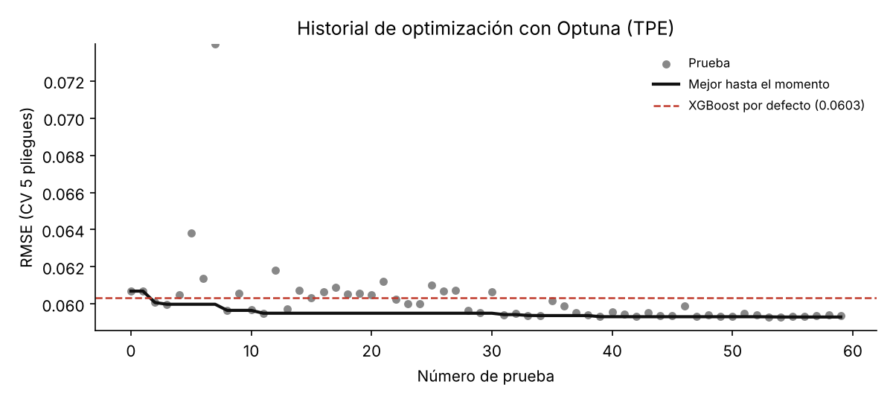
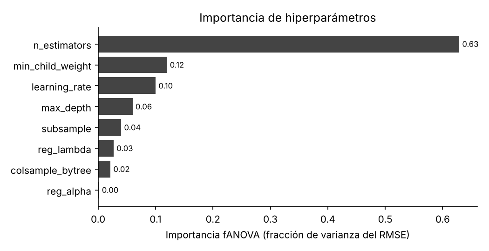
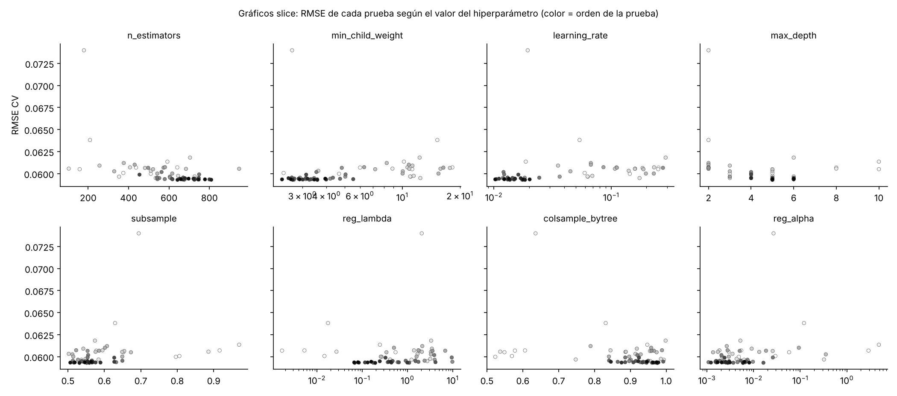
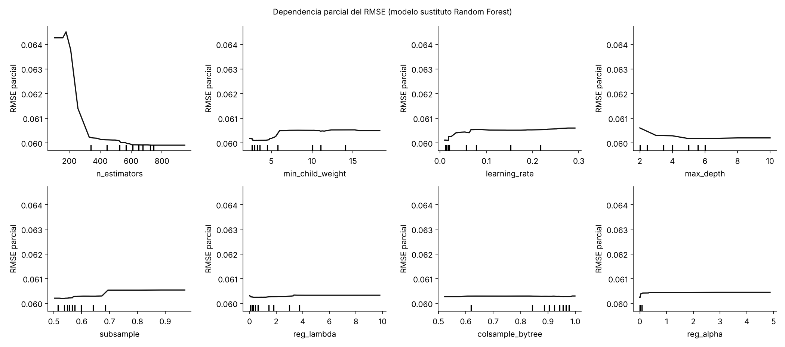
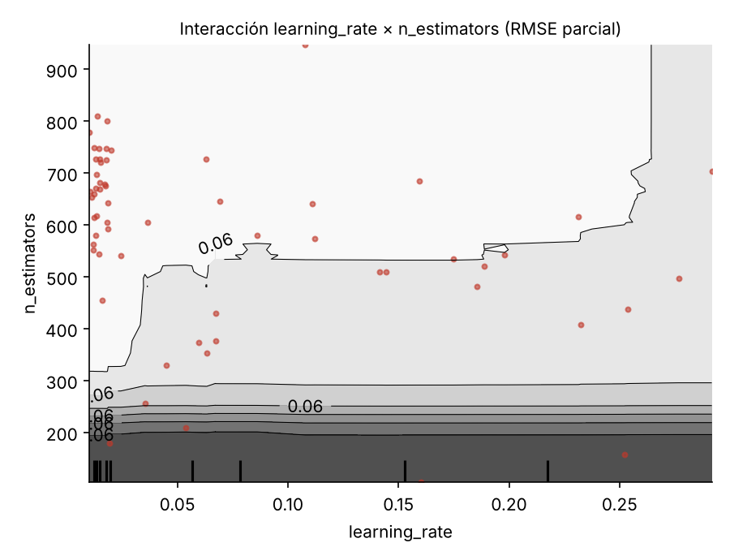
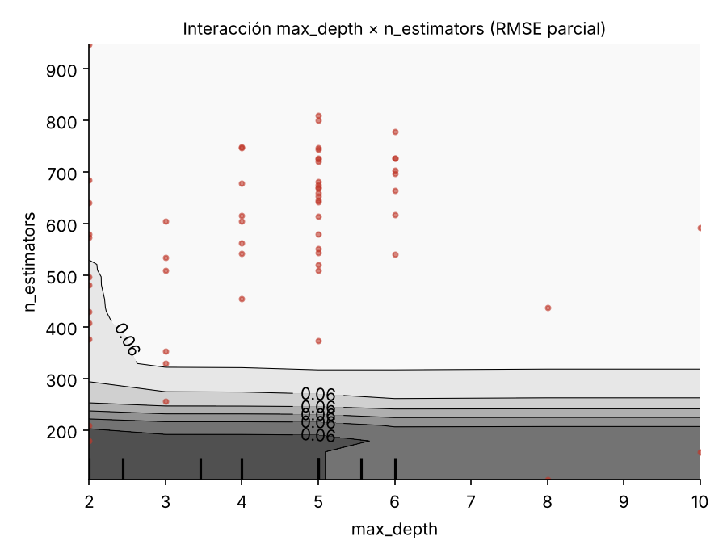
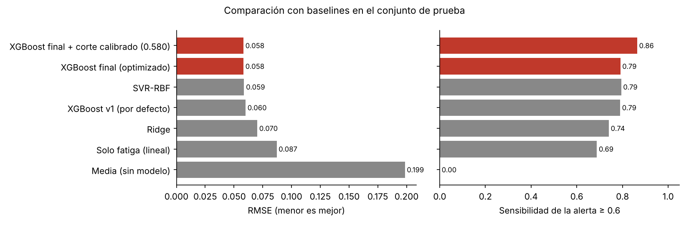
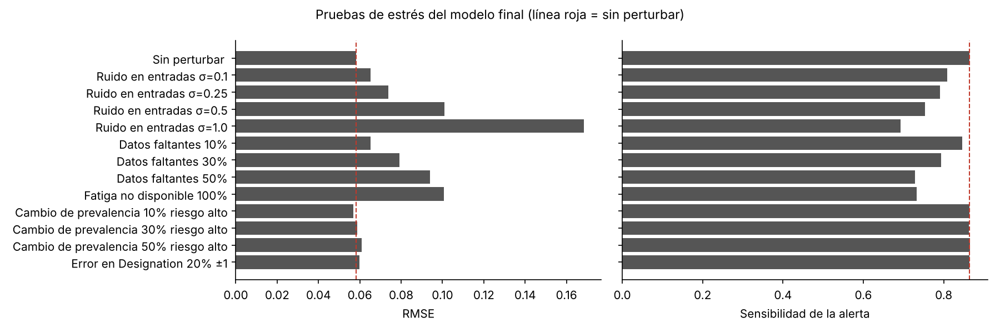

# Optimización de hiperparámetros y validación del modelo

Este documento aplica la metodología del Workshop de optimización (simulación de escenarios críticos y análisis de sensibilidad de hiperparámetros) al modelo de burnout. El código está en [`src/optimize.py`](../src/optimize.py) y [`src/evaluate.py`](../src/evaluate.py). El proceso ejecutado, con sus salidas, está en [`notebooks/04_optimizacion.ipynb`](../notebooks/04_optimizacion.ipynb) y [`notebooks/05_evaluacion.ipynb`](../notebooks/05_evaluacion.ipynb).

## 1. Proceso de optimización

| Aspecto | Decisión |
|---|---|
| Método | Búsqueda bayesiana con Optuna, muestreador TPE (*Tree-structured Parzen Estimator*), semilla 42 |
| Presupuesto | 60 pruebas |
| Función objetivo | RMSE promedio de validación cruzada de 5 pliegues, calculado **solo con el conjunto de entrenamiento** (17 300 registros) |
| Protección contra fuga | El preprocesamiento se reajusta dentro de cada pliegue (`Pipeline`); el conjunto de prueba se usa una única vez, al final |
| Tiempo | Unos 2 minutos en CPU |

## 2. Hiperparámetros explorados y rangos

| Hiperparámetro | Rango | Escala | Qué controla |
|---|---|---|---|
| `n_estimators` | 100 a 1000 | Entera | Número de árboles |
| `learning_rate` | 0.01 a 0.30 | Logarítmica | Contribución de cada árbol |
| `max_depth` | 2 a 10 | Entera | Complejidad de cada árbol |
| `min_child_weight` | 1 a 20 | Logarítmica | Tamaño mínimo de hoja (regularización) |
| `subsample` | 0.5 a 1.0 | Lineal | Fracción de filas por árbol |
| `colsample_bytree` | 0.5 a 1.0 | Lineal | Fracción de columnas por árbol |
| `reg_lambda` | 0.001 a 10 | Logarítmica | Penalización L2 |
| `reg_alpha` | 0.001 a 10 | Logarítmica | Penalización L1 |

La búsqueda supera la configuración por defecto desde la tercera prueba y se estabiliza alrededor de la prueba 30. La mediana de las 60 pruebas (RMSE 0.0597) ya es mejor que XGBoost por defecto (0.0603).

## 3. Resultados del análisis de sensibilidad

### 3.1 Ranking de importancia de hiperparámetros

Importancia estimada con fANOVA: fracción de la variación del RMSE entre pruebas que explica cada hiperparámetro.

| Puesto | Hiperparámetro | Importancia | Lectura |
|---|---|---|---|
| 1 | `n_estimators` | 0.63 | Determinante: con menos de unos 300 árboles el modelo queda subajustado |
| 2 | `min_child_weight` | 0.12 | Valores bajos (menos de 5) son ligeramente mejores |
| 3 | `learning_rate` | 0.10 | Tasas bajas (cerca de 0.02) con muchos árboles dan los mejores resultados |
| 4 | `max_depth` | 0.06 | Profundidad 2 rinde peor; de 4 en adelante el efecto es plano |
| 5 | `subsample` | 0.04 | Efecto menor |
| 6 | `reg_lambda` | 0.03 | Casi sin efecto |
| 7 | `colsample_bytree` | 0.02 | Casi sin efecto (solo hay 7 columnas) |
| 8 | `reg_alpha` | 0.00 | Sin efecto: puede fijarse |

### 3.2 Gráficos slice

Cada punto es una prueba; el color indica el orden (más oscuro, más tardía). Se aprecia cómo TPE concentra las pruebas tardías en `learning_rate` bajo y `n_estimators` alto.

### 3.3 Partial dependence plots

Como las pruebas no forman una grilla, se ajustó un **modelo sustituto** (Random Forest de 400 árboles) que predice el RMSE a partir de los hiperparámetros, y sobre él se calculó la dependencia parcial de cada uno.

* `n_estimators` muestra un codo claro: el RMSE parcial baja de 0.064 a 0.060 entre 150 y 350 árboles y luego se aplana.
* `learning_rate`, `min_child_weight` y `subsample` tienen pendientes suaves con preferencia por valores bajos.
* `reg_lambda`, `colsample_bytree` y `reg_alpha` son prácticamente planos: no merecen presupuesto de búsqueda.

### 3.4 Análisis de interacciones

Se calculó el estadístico H de Friedman sobre el modelo sustituto (0 = efectos puramente aditivos):

| Par | H |
|---|---|
| `max_depth` × `n_estimators` | 0.043 |
| `learning_rate` × `n_estimators` | 0.038 |
| `n_estimators` × `min_child_weight` | 0.035 |

Las interacciones son débiles en el rango explorado. El contorno `learning_rate` × `n_estimators` muestra la compensación esperada: la región de menor error combina tasas bajas con más de unos 320 árboles. Con tasas altas, agregar árboles ya no mejora. La lectura de zonas con pocas pruebas (tasas altas) debe tomarse con cautela, porque el sustituto extrapola donde TPE muestreó poco.

**Recomendación derivada:** en futuras búsquedas basta con explorar `n_estimators`, `learning_rate` y `min_child_weight`, y fijar el resto.

## 4. Configuración final seleccionada y justificación

| Hiperparámetro | Valor final | Justificación |
|---|---|---|
| `n_estimators` | 642 | En la meseta de mínimo error del PDP |
| `learning_rate` | 0.0185 | Tasa baja: mejor generalización con muchos árboles |
| `max_depth` | 5 | Suficiente para captar los escalones por nivel jerárquico |
| `min_child_weight` | 3.59 | Regularización moderada |
| `subsample` | 0.532 | Submuestreo de filas que añade aleatoriedad (efecto menor) |
| `colsample_bytree` | 0.975 | Prácticamente todas las columnas |
| `reg_lambda` | 0.194 | Efecto despreciable; se deja el valor encontrado |
| `reg_alpha` | 0.0059 | Efecto despreciable; se deja el valor encontrado |

Los valores se guardan en `config.yaml` (redondeados) y en `models/best_params.json` (exactos).

Además de los hiperparámetros, la optimización del sistema incluyó dos decisiones de diseño validadas con datos de entrenamiento:

1. **Indicador de dato faltante** para fatiga y carga: reduce el RMSE de validación cruzada de 0.0615 a 0.0603 con parámetros por defecto, y beneficia sobre todo a las personas sin dato de fatiga.
2. **Corte de la alerta calibrado:** el modelo contrae sus predicciones hacia el centro, de modo que alertar solo cuando la predicción es ≥ 0.60 detecta el 79 % de los casos reales. Con predicciones fuera de muestra de entrenamiento se eligió el corte más alto que asegura al menos 85 % de sensibilidad: **0.58**.

## 5. Comparación antes y después de la optimización

| Versión | RMSE CV (train) | RMSE test | R² test | Sensibilidad | Precisión | F1 |
|---|---|---|---|---|---|---|
| Baseline una variable (solo fatiga) | 0.0866 | 0.0871 | 0.808 | 0.688 | 0.850 | 0.760 |
| XGBoost por defecto, sin indicador (`model_v1.pkl`) | 0.0615 | 0.0601 | 0.909 | 0.790 | 0.826 | 0.808 |
| Configuración manual previa a Optuna | 0.0597 | | | | | |
| XGBoost optimizado con indicador, corte 0.60 | 0.0593 | 0.0582 | 0.914 | 0.790 | 0.838 | 0.814 |
| **XGBoost optimizado con indicador, corte 0.58 (final)** | **0.0593** | **0.0582** | **0.914** | **0.864** | **0.778** | **0.819** |

* La optimización de hiperparámetros reduce el RMSE de validación cruzada un 1.7 % frente a XGBoost por defecto y el de prueba un 3.2 %. La mejora es real pero modesta: el modelo está cerca del límite que permiten las variables disponibles, algo esperable cuando una sola variable explica el 81 % de la varianza.
* El mayor salto práctico proviene del corte calibrado: la sensibilidad sube 7.4 puntos (de 79.0 % a 86.4 %) a cambio de 6 puntos de precisión, y el F1 también mejora.
* Frente al baseline de una variable, el modelo final reduce el RMSE un 33 % y detecta 18 puntos más de casos de riesgo alto.

## 6. Validación en escenarios críticos (pruebas de estrés)

Se aplicaron al modelo final perturbaciones controladas sobre el conjunto de prueba, cada una repetida 10 veces con semillas distintas. **Criterio de aceptación definido antes de ver los resultados:** caída máxima de 5 puntos en la sensibilidad de la alerta.

| Escenario | Nivel | RMSE | Sensibilidad | Precisión | Veredicto |
|---|---|---|---|---|---|
| Sin perturbar | | 0.058 | 0.864 | 0.778 | Referencia |
| Ruido en fatiga y carga | σ = 0.10 × desv. est. | 0.065 | 0.809 | 0.818 | Falla (−5.5) |
| Ruido en fatiga y carga | σ = 0.25 | 0.074 | 0.791 | 0.795 | Falla |
| Ruido en fatiga y carga | σ = 0.50 | 0.101 | 0.754 | 0.707 | Falla |
| Ruido en fatiga y carga | σ = 1.00 | 0.168 | 0.693 | 0.547 | Falla |
| Datos faltantes aleatorios | 10 % | 0.065 | 0.846 | 0.773 | Cumple (−1.8) |
| Datos faltantes aleatorios | 30 % | 0.079 | 0.794 | 0.763 | Falla |
| Datos faltantes aleatorios | 50 % | 0.094 | 0.729 | 0.749 | Falla |
| Fatiga no disponible | 100 % | 0.101 | 0.733 | 0.696 | Falla |
| Cambio de prevalencia | 10 % de riesgo alto | 0.057 | 0.864 | 0.552 | Cumple (precisión baja) |
| Cambio de prevalencia | 30 % | 0.059 | 0.862 | 0.824 | Cumple |
| Cambio de prevalencia | 50 % | 0.061 | 0.866 | 0.917 | Cumple |
| Error de captura en Designation | 20 % de casos ± 1 nivel | 0.060 | 0.864 | 0.774 | Cumple |
| Cambio de población (entrenar en *Service*, evaluar en *Product*) | | 0.060 | 0.764* | | Cumple |

\* El escenario de cambio de población usa un modelo reentrenado solo con empresas de servicios y el corte de 0.6; su referencia en el mismo grupo es 0.776 (diferencia de 1.2 puntos).

**Conclusiones para producción**

* El modelo es robusto a cambios de prevalencia, a errores en el nivel jerárquico y a desplegarse en otro tipo de empresa.
* Es **sensible a la calidad de la medición de la fatiga**: un ruido pequeño (10 % de su desviación estándar) ya cruza el criterio. El sistema depende de un instrumento de fatiga confiable y aplicado de forma consistente.
* Cuando la prevalencia real es baja, casi la mitad de las alertas serían falsas. Esto respalda que la alerta solo invite a una conversación voluntaria de bienestar.
* Plan de monitoreo: vigilar la tasa de datos faltantes de fatiga (alerta si supera el 10 %) y la distribución de la fatiga y del *Burn Rate* predicho. Revalidar el modelo si cambian de forma significativa.
